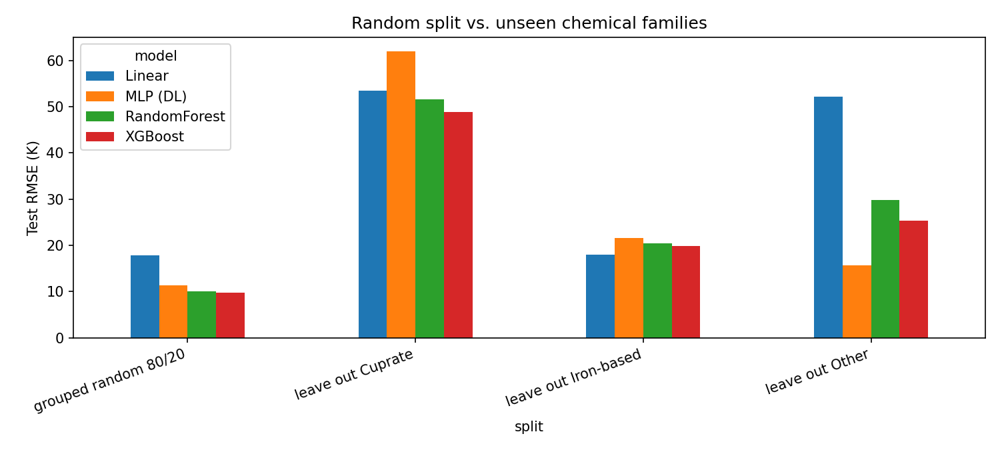

# Assessing Generalization in Superconducting Critical Temperature Prediction Across Chemical Systems

[](https://colab.research.google.com/github/neajaw/sc-tc-generalization/blob/main/notebooks/tc_prediction.ipynb)

Machine learning models can predict the critical temperature (Tc) of known superconductors with high accuracy. This project asks a harder question: **do those models still work on chemical families they have never seen?**

## What this project does

1. Predicts Tc from 81 composition-derived features using:
   - **Classical ML:** Linear Regression, Random Forest, XGBoost
   - **Deep learning:** a PyTorch multilayer perceptron with dropout and early stopping
2. Evaluates with a **grouped split** by chemical formula, so the same compound never appears in both training and test sets.
3. Interprets the best model with **SHAP** to identify which physical properties drive Tc.
4. Tests **generalization across chemical systems** with leave-one-family-out evaluation over three families: cuprates, iron-based superconductors and others.

## Dataset

[UCI Superconductivity Data](https://archive.ics.uci.edu/dataset/464/superconductivty+data): 21,263 superconductors with 81 features and measured Tc. The notebook downloads it automatically.

- `train.csv`: 81 features plus `critical_temp`
- `unique_m.csv`: element counts, `critical_temp` and the chemical formula (`material`), in the same row order

## How to run

**Google Colab (recommended):** click the badge above, set **Runtime → Change runtime type → T4 GPU**, then **Runtime → Run all**.

**Locally:**

```bash
pip install -r requirements.txt
jupyter notebook notebooks/tc_prediction.ipynb
```

Figures are saved to `figures/` and the metrics table to `results/results.csv`.

## Repository structure

```
sc-tc-generalization/
├── notebooks/
│   └── tc_prediction.ipynb   # full pipeline: data → ML/DL → SHAP → generalization
├── figures/                  # generated plots
├── results/                  # generated metrics (results.csv)
├── requirements.txt
└── README.md
```

## Results

| Model | Grouped random split RMSE (K) | Leave out Cuprate | Leave out Iron-based | Leave out Other |
|---|---|---|---|---|
| Linear Regression | 17.88 | 53.51 | 17.95 | 52.21 |
| Random Forest | 10.09 | 51.60 | 20.39 | 29.76 |
| XGBoost | **9.77** | **48.84** | 19.90 | 25.27 |
| MLP (deep learning) | 11.39 | 61.91 | 21.52 | **15.62** |

**R² on the test set:**

| Model | Grouped random split | Leave out Cuprate | Leave out Iron-based | Leave out Other |
|---|---|---|---|---|
| Linear Regression | 0.726 | −1.95 | **−0.97** | −37.38 |
| Random Forest | 0.913 | −1.74 | −1.55 | −11.47 |
| XGBoost | **0.918** | **−1.46** | −1.43 | −7.99 |
| MLP (deep learning) | 0.889 | −2.95 | −1.84 | **−2.44** |



### Key findings

- **High accuracy within known chemistry.** On a random test split grouped by chemical formula, XGBoost predicts Tc with an RMSE of 9.77 K (R² = 0.918), matching the benchmark reported by Hamidieh (2018).
- **Poor transfer to unseen chemical families.** When an entire family is held out of training, errors rise up to five-fold, and every model obtains a negative R² on every held-out family. In other words, the models predict Tc for a new family less accurately than simply guessing that family's average Tc.
- **Cuprates are the hardest case.** Cuprates hold the highest Tc values (up to about 140 K) and make up about half the dataset. Without them, the training data contains almost no high-Tc materials, and tree-based models cannot predict values outside the range they were trained on.
- **The best model depends on the test.** XGBoost is best on the random split and when cuprates are held out, linear regression is best when iron-based superconductors are held out, and the neural network is best when the "Other" family is held out. Ranking models on a random split therefore does not reveal which model will generalize to new chemistry.

**Conclusion:** standard random-split evaluation overstates how useful machine learning is for discovering new superconductor families. These models learn family-specific patterns rather than transferable physics, so cross-family evaluation should be routine when ML is used to screen for new superconductors.

## Acknowledgments

Code and documentation for this project were developed with the help of Claude, an AI assistant made by Anthropic. I defined the research question, ran all experiments in Google Colab, and reviewed and verified the results.

## Reference

Hamidieh, K. (2018). A data-driven statistical model for predicting the critical temperature of a superconductor. *Computational Materials Science*, 154, 346–354.

## License

This project is licensed under the MIT License; see [LICENSE](LICENSE).
